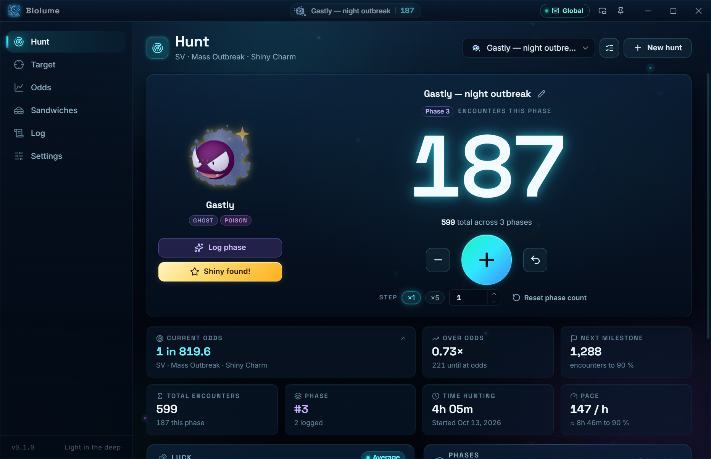
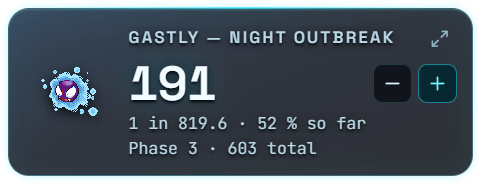
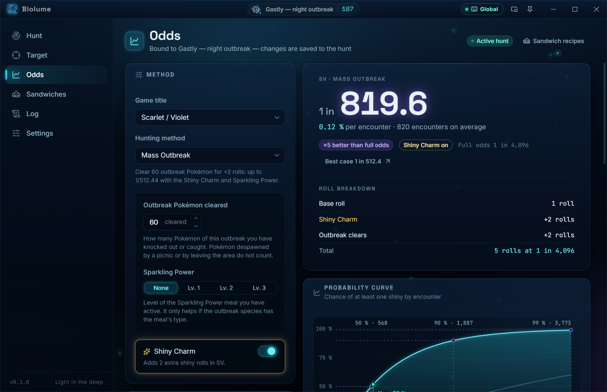
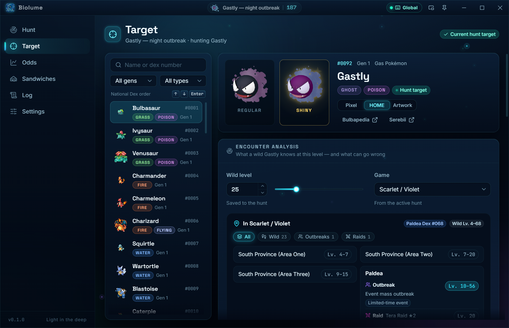
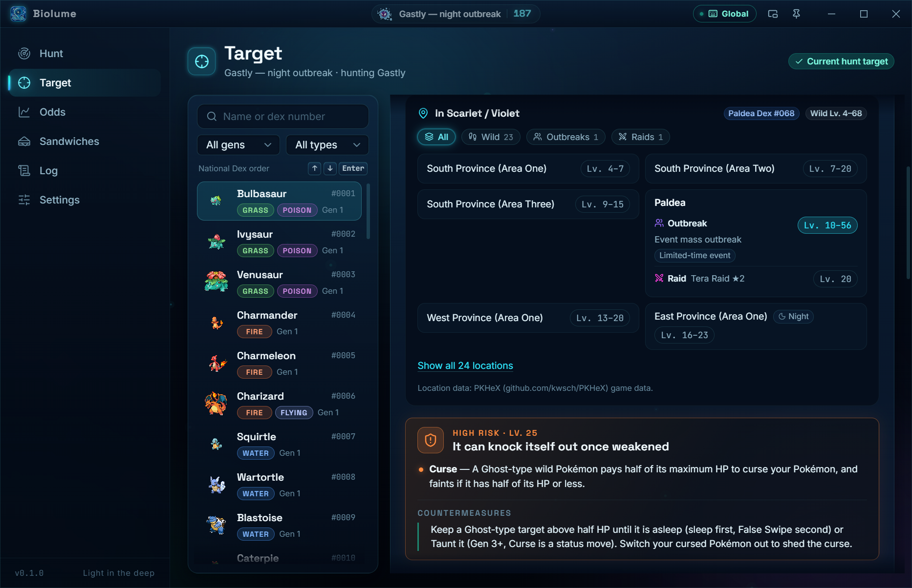
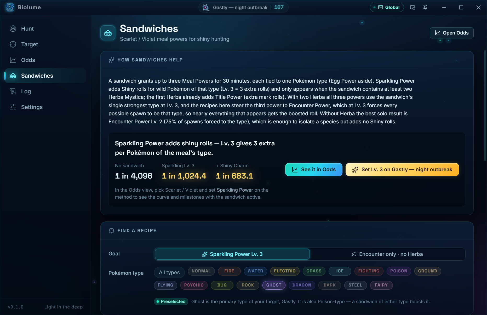
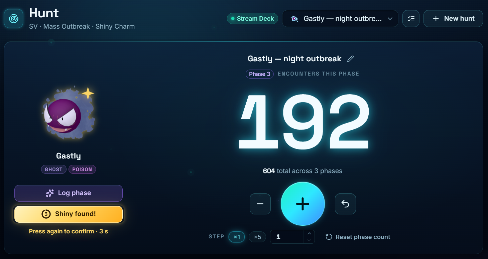
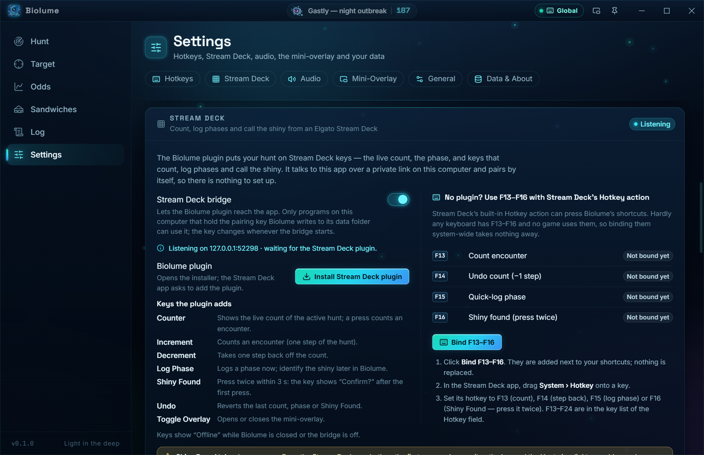

<p align="center">
  
</p>

<p align="center">
  <b>A shiny hunting companion for Pokémon, from Gold &amp; Silver to Legends: Z-A.</b><br>
  Count without leaving your game, know your real odds, and find out exactly where your target lives.
</p>

<p align="center">
  
  <a href="#elgato-stream-deck"></a>
  
  
  <a href="https://github.com/HydrosPlays/Biolume/releases"></a>
</p>

<p align="center">
  
</p>

## Contents

- [Download](#download)
- [Features](#features)
  - [Counter](#counter)
  - [Mini-overlay and global hotkeys](#mini-overlay-and-global-hotkeys)
  - [Odds engine](#odds-engine)
  - [Target analyzer and locations](#target-analyzer-and-locations)
  - [Sandwich helper](#sandwich-helper)
  - [Elgato Stream Deck](#elgato-stream-deck)
  - [Log and your data](#log-and-your-data)
- [Troubleshooting](#troubleshooting)
- [Known limitations](#known-limitations)
- [Building from source](#building-from-source)
- [Data sources and credits](#data-sources-and-credits)

## Download

Grab the latest version from the [Releases page](https://github.com/HydrosPlays/Biolume/releases/latest):

| File                      | What it is                                                                |
| ------------------------- | ------------------------------------------------------------------------- |
| `Biolume Setup x.y.z.exe` | Installer: choose an install folder, get Start-menu and desktop shortcuts |
| `Biolume x.y.z.exe`       | Portable: nothing to install, just run it                                 |

GitHub shows the spaces in these file names as dots (`Biolume.Setup.0.1.0.exe`).

Biolume runs on Windows 10 and 11 (64-bit).

> [!NOTE]
> **"Windows protected your PC"?** Biolume isn't code-signed yet, so SmartScreen warns about it the first
> time. Click **More info → Run anyway**.

## Features

### Counter

- A big counter for the current phase, with steps of ×1, ×5 or any size, undo, and a phase reset
- Live stats: current odds, how far over odds you are, the next milestone, total encounters, time hunted,
  pace per hour and how lucky the hunt has been so far
- **Phase log**: got a shiny that isn't your target? Log the phase now and identify it later
- Sound on every count, with four sound packs (sonar, bubble, click, chime) and milestone chimes
- Sessions are tracked automatically, and finished hunts are kept as trophies

### Mini-overlay and global hotkeys

<p align="center">
  
</p>

The mini-overlay is a small always-on-top counter that floats over your game. You can change its opacity,
size and what it shows, and make it click-through.

Global hotkeys let you count without leaving the game:

- While Biolume is in the background, minimised, or hidden behind the mini-overlay, the keys you bind are
  registered with the operating system and captured system-wide. A registered key does not reach the game.
- While a Biolume window has focus, the same keys are handled inside the app instead, so keys such as
  Space stay typeable in text fields.
- Settings → Hotkeys shows whether each shortcut was registered. A key another program already owns is
  reported as unavailable. The whole feature can be switched off there.

Defaults: `Num +` counts, `Num -` takes one step back, `Ctrl+Shift+B` toggles the mini-overlay. Undo, quick
phase log and Shiny Found can be bound too.

### Odds engine



- **17 games and 67 methods**, from Gold / Silver / Crystal to Legends: Z-A: Masuda Method, Poké Radar,
  chain fishing, Friend Safari, DexNav, SOS chaining, Ultra Wormholes, Catch Combo, Dynamax Adventures,
  Mass Outbreaks, Tera Raids, Hyperspace Sparkling Power and more
- Shiny Charm, outbreak clears and other inputs per method, with a roll-by-roll breakdown
- A probability curve with the encounters you need for a 50 %, 90 % and 99 % chance
- In Scarlet / Violet, **Sparkling Power** (sandwiches) is a setting on the Full odds and Mass Outbreak
  methods
- Every method lists its sources, and all 316 odds checkpoints are re-checked by `npm run data:validate`

### Target analyzer and locations

<table>
  <tr>
    <td width="50%"></td>
    <td width="50%"></td>
  </tr>
</table>

- Search every Pokémon, including forms and regional variants, by name or dex number
- See the moveset a wild Pokémon has at your level, with a warning for any move that can ruin a hunt:
  self-KOs, moves that end the battle, recoil, delayed KOs and more, each with countermeasures
- **Where to find it**, for every game from Gold / Silver / Crystal to Legends: Z-A: every location, how
  it's met (walking, surfing, fishing, outbreaks, raids, static or gift), levels, rates, time and season
  conditions, version exclusives and shiny locks

### Sandwich helper



For Scarlet / Violet: see how much a sandwich helps, find a recipe for your target's type (Sparkling
Power Lv. 3, or encounter power without Herba Mystica), and set Sparkling Power on your hunt in one click.

### Elgato Stream Deck

<table>
  <tr>
    <td width="50%"></td>
    <td width="50%"></td>
  </tr>
</table>

Biolume works with the Elgato Stream Deck in two ways: through its own plugin, or with no plugin at all
through Stream Deck's built-in Hotkey action. Either way the keys change the same hunt as the Hunt view,
which updates, plays its sounds and animates as if you had clicked.

**Plugin.** Open Settings → Stream Deck and choose **Install Stream Deck plugin**; the Stream Deck app
(7.1 or newer) asks to add it. The plugin adds these actions:

| Action         | What it does                                                           |
| -------------- | ---------------------------------------------------------------------- |
| Counter        | Shows the live count of the active hunt; a press counts one encounter  |
| Increment      | Counts one encounter (one step of the hunt)                            |
| Decrement      | Takes one step back off the count                                      |
| Log Phase      | Logs a phase; identify the shiny later in Biolume                      |
| Shiny Found    | Press twice within 3 s: the key shows "Confirm?" after the first press |
| Undo           | Reverts the last count, phase or Shiny Found                           |
| Toggle Overlay | Opens or closes the mini-overlay                                       |

Keys show "Offline" while Biolume is closed or the bridge is switched off. The Hunt view shows a "Stream
Deck" chip while the plugin is connected.

**Shiny Found takes two presses.** From the Stream Deck or a hotkey, the first press only arms it: the key
and the Hunt view's "Shiny found!" button light up gold, with a countdown. A second press within 3 seconds
completes the hunt; otherwise nothing happens. A stray tap can never end a hunt, holding a hotkey down
counts as a single press, and Undo still takes a confirmed one back. The Hunt view's own button completes
at once.

**No plugin: F13–F16 with the Hotkey action.** F13 to F24 exist on hardly any keyboard and no game uses
them, so Biolume can register them system-wide without taking a key away from anything.

1. In Settings → Stream Deck, choose **Bind F13–F16**. It adds F13 (count), F14 (one step back), F15 (log
   phase) and F16 (Shiny Found) next to your existing shortcuts; a key that another action already uses
   is left alone and reported.
2. In the Stream Deck app, drag **System → Hotkey** onto a key and set its hotkey to one of those keys
   (F13 to F24 are in the Hotkey field's key list).
3. Keep **Global hotkeys** on under Settings → Hotkeys, so the keys work while your game has focus.

The Hotkey route has no live count on the keys; Shiny Found on F16 still needs two presses.

<details>
<summary><b>Pairing and security</b></summary>

The plugin talks to Biolume over a small HTTP bridge that listens on `127.0.0.1` only, so nothing outside
this computer can reach it. When the bridge starts it writes a pairing file (`streamdeck-bridge.json`, with
the port and a fresh random token) to its data folder, and deletes it — revoking that token — when it stops
or Biolume quits. The plugin runs as the same user, reads the file and sends the token with every request,
so there is nothing to set up. Requests without the token, and any request a web page makes (browsers
always send an `Origin` header), are refused. Switch the bridge off under Settings → Stream Deck if you do
not use it.

</details>

### Log and your data

The Log view has four tabs: **Phases**, **Sessions**, **Trophies** (finished hunts) and **Data**.

Everything is stored locally as plain JSON in `%APPDATA%\Biolume`: `hunts.json`, `sessions.json`,
`settings.json` and `window-state.json`. Saves are atomic and the previous good copy of each file is kept
beside it as `.bak`. Settings → Data & About and Log → Data show the exact path and open the folder.

Export and import live under Log → Data:

| Dataset     | Formats   | Contents                                              |
| ----------- | --------- | ----------------------------------------------------- |
| Full backup | JSON      | Hunts with their phases, session history and settings |
| Sessions    | JSON, CSV | One record per hunting session                        |
| Phases      | JSON, CSV | One record per logged phase                           |
| Targets     | JSON, CSV | One record per hunt target                            |

Import detects which kind of file it was given. **Merge** keeps what you have and adds or updates records
by id; **Replace** swaps your data for the file's and always asks first. Restore from a full backup.

## Troubleshooting

- **SmartScreen blocks the exe.** Biolume isn't code-signed yet: click **More info → Run anyway**.
- **The mini-overlay disappears in game.** Games in exclusive fullscreen can cover it. Run the game in
  borderless or windowed mode.
- **A hotkey shows as unavailable.** Another program already owns that key. Pick a different one under
  Settings → Hotkeys.
- **Stream Deck keys show "Offline".** Biolume is closed, or the bridge is switched off under Settings →
  Stream Deck. The keys reconnect by themselves once it's back.

## Known limitations

- Night-only spawns aren't marked in Brilliant Diamond / Shining Pearl, Legends: Arceus or Legends: Z-A,
  because the game data doesn't record time of day.
- The X / Y Friend Safari isn't in the locations list (PokéAPI doesn't have it).
- Windows builds only for now. The code also builds for macOS and Linux, but those aren't tested.
- The Stream Deck plugin is brand new. If a key looks or behaves wrong, please
  [open an issue](https://github.com/HydrosPlays/Biolume/issues).

## Building from source

You need Node.js 22.12 or newer (24 LTS recommended) and npm.

```bash
npm install
npm run dev
```

<details>
<summary><b>All commands</b></summary>

| Command                                               | What it does                                                                                           |
| ----------------------------------------------------- | ------------------------------------------------------------------------------------------------------ |
| `npm install`                                         | Install dependencies                                                                                   |
| `npm run dev`                                         | Run the app with hot reload                                                                            |
| `npm run build`                                       | Type-check, then build main, preload and renderer into `out/`                                          |
| `npm start`                                           | Build and run the production build (`electron-vite preview`)                                           |
| `npm test`                                            | Unit and component tests (Vitest)                                                                      |
| `npm run lint`                                        | ESLint                                                                                                 |
| `npm run typecheck`                                   | TypeScript for the main and renderer projects                                                          |
| `npm run smoke`                                       | Build, then run the end-to-end smoke test (see below)                                                  |
| `npm run dist`                                        | Pack the Stream Deck plugin, build, and package Windows installers (NSIS and portable) into `release/` |
| `npm run streamdeck:pack`                             | Build, smoke-test and pack the Stream Deck plugin into `build/streamdeck/`                             |
| `npm run streamdeck:test`                             | The Stream Deck plugin's tests                                                                         |
| `npm run data:validate`                               | Re-check every odds checkpoint and risk move in the bundled data files                                 |
| `npm run data:build`                                  | Regenerate the bundled species and move indexes from the PokeAPI CSV dumps (needs a connection)        |
| `npm run data:locations`                              | Regenerate the PokéAPI location-name index                                                             |
| `npm run data:za`, `data:bdsp`, `data:pla`, `data:sv` | Re-extract a game's encounter data from PKHeX                                                          |

In a development checkout, run `npm run streamdeck:pack` once before using **Install Stream Deck plugin**;
without the packed installer the button is disabled.

</details>

<details>
<summary><b>Smoke test</b></summary>

`npm run smoke` starts the real app against a throw-away data directory without showing a window. It
seeds a demo hunt, screenshots every view into `.smoke/` (including each view at the minimum window size
of 940x600), drives the IPC bridge, the global hotkeys, the Stream Deck bridge, the overlay, export / import
and persistence, then prints one line `[smoke] {...}` and exits with 0 when everything passed. The
screenshots in this README come from it.

Set `BIOLUME_SMOKE_TOUR=1` to add review screenshots (`tour-*.png`): every view scrolled page by page,
each Log tab, the Hunt dialogs and the completed-hunt summary.

`BIOLUME_USER_DATA=<directory>` points a normal run at a different data directory.

</details>

<details>
<summary><b>Project layout</b></summary>

```
src/
  shared/      Domain types, defaults and the window.biolume IPC contract, used by both processes
  main/        Electron main process: the state store (single source of truth), JSON storage,
               windows, global hotkeys, the Stream Deck bridge, IPC handlers, export / import,
               security policy, smoke test
               preload.ts exposes the typed window.biolume bridge to the renderers
  renderer/
    api/         Cached PokeAPI client (TanStack Query, persisted in IndexedDB)
    components/  One file per view (Counter, TargetSearch, OddsEngine, SandwichHelper, LogView,
                 SettingsView, OverlayView, PhaseDialog) with a folder of parts for each,
                 layout/ (app shell, title bar, sidebar) and ui/ (the component kit)
    data/        Bundled data: oddsMethods.json, riskMoves.json, species and move indexes,
                 locationIndex.json, encounters/<game>.json, zaLearnsets.json
    hooks/       Routing, in-app hotkeys, counter feedback, keyboard capture
    lib/         Odds engine and formulas, probability maths, moveset prediction, risk analysis,
                 encounters, species search, sprites, formatting, audio
    store/       zustand mirror of the main-process state, plus the actions that call it
    styles/      Design tokens and base styles
streamdeck/    The Elgato Stream Deck plugin (app.biolume.streamdeck), built on the Elgato SDK
scripts/       Data build and validation scripts; scripts/pkhex/ reads PKHeX's game data
```

The main process owns all state. Renderers call an action over IPC and update from the event that comes
back, so the main window and the overlay always agree.

</details>

## Data sources and credits

- Species, moves, learnsets and sprites come from [PokéAPI](https://pokeapi.co/) and its sprite
  repository. Responses are cached on your computer; a small species and move index is bundled so search
  works offline.
- **Where to find a Pokémon** comes from two sources:
  - **PokéAPI** (`/pokemon/{id}/encounters`) for Gold / Silver / Crystal through Sword / Shield, including
    Let's Go and the Isle of Armor / Crown Tundra. PokéAPI only lists where a Pokémon is met, so the panel
    never claims a Pokémon is missing from one of these games, and it has no shiny-lock flags.
  - **[PKHeX](https://github.com/kwsch/PKHeX)'s game data** (GPL-3.0) for Brilliant Diamond / Shining
    Pearl, Legends: Arceus, Scarlet / Violet (with the Teal Mask and the Indigo Disk) and Legends: Z-A
    (with Mega Dimension). Only facts are taken (species, places, levels, conditions, shiny locks),
    re-keyed to PokéAPI's ids.
- **Legends: Z-A** level-up learnsets are bundled from PKHeX's data, because PokéAPI lists the game but has
  no learnsets for it yet; when PokéAPI adds its own, those take precedence automatically.
- Shiny odds, method notes and sandwich recipes are in `src/renderer/data/oddsMethods.json`. Every method
  and recipe lists its own sources (Bulbapedia, Serebii, datamine write-ups and others).
- Risk moves are in `src/renderer/data/riskMoves.json`.
- Stream Deck plugin built with the [Elgato Stream Deck SDK](https://docs.elgato.com/streamdeck/sdk/introduction/getting-started/).
- Fonts: Space Grotesk, Inter and JetBrains Mono (SIL Open Font License). Icons: [Lucide](https://lucide.dev/).

## Disclaimer

Biolume is an unofficial, fan-made tool. It is not affiliated with, endorsed or sponsored by Nintendo,
Game Freak, Creatures or The Pokémon Company. Pokémon and Pokémon character names are trademarks of
their respective owners.
